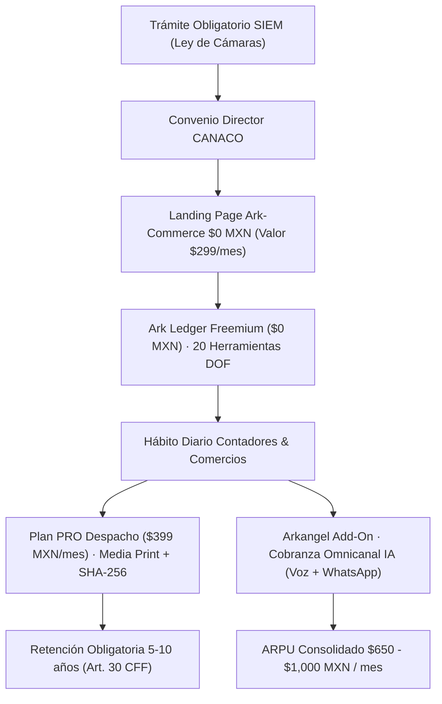

# ESTRATEGIA COMERCIAL ARK SALES: ALIANZA CANACO, ARK LEDGER Y ARKANGEL

## 1. La Epifanía y el Flywheel Operativo
El objetivo primordial de **Ark Sales** es vender las suscripciones de **Ark Ledger** y los consumos de **Arkangel** utilizando **Ark Commerce** como oferta anzuelo (Caballo de Troya) para el Director de CANACO y sus cámaras filiales.



---

## 2. Propuesta Comercial para el Director de CANACO
1. **El Regalo Institucional:** A cada agremiado de la CANACO (pequeño o grande) se le otorga una **Landing Page comercial / Tienda digital de Ark Commerce al 100% sin costo** (precio regular de lista: $299 MXN/mes).
2. **Financiamiento:** Para ARK no es un costo hundido, sino nuestro **Costo de Adquisición de Clientes (CAC ~$0 MXN)**.
3. **El Canal SIEM:** Todo negocio formal en México debe tramitar por ley su registro en el **SIEM (Sistema de Información Empresarial Mexicano)** ante la CANACO. La cámara entrega la Landing Page como un valor agregado premium de la membresía sin costo adicional, logrando penetración del 100% de los agremiados.

---

## 3. Estructura de Precios y Monetización (Pricing Tiers)

### A. Nivel Freemium (Captación y Enganche)
- **Costo:** **$0 MXN**.
- **Incluye:** Uso ilimitado de las 20 herramientas fiscales y financieras DOF para realizar cálculos, simulaciones y proyecciones en pantalla.
- **Límite:** Hasta 10 consultas mensuales con el Asistente de IA (Noah AI).
- **Objetivo:** Generar hábito diario en contadores, despachos y comercios sin fricción de tarjeta de crédito.

### B. Plan PRO Despacho (Monetización del Valor Operativo)
- **Costo:** **$399 MXN / mes** por despacho contable.
- **Desbloquea:**
  1. Impresión de Papeles de Trabajo Oficiales en formato Carta (`@media print`).
  2. Sellado Criptográfico SHA-256 inmutable + Código QR de Verificación Pública sin login (`/verify`).
  3. Consultas ilimitadas de IA (Workers AI / Llama 3.3 70B con Noah AI).
  4. Expediente Único y almacenamiento multi-tenant en la nube con resguardo obligatorio por 5 a 10 años conforme al Art. 30 del CFF.

### C. Motor de Comunicaciones Omnicanal (Arkangel Add-On)
Se factura por consumo real (minutos y mensajes procesados):
- **Voz AI (Llamada + STT + LLM + TTS):** **$0.25 USD / minuto**.
- **WhatsApp Business (con Motor Legal fail-closed):** **$0.20 USD / mensaje**.
- **SMS Transaccional:** **$0.15 USD / mensaje**.
- **Email Transaccional:** **$0.06 USD / correo**.
- **Módulo Fiscal Corporativo (Add-on Enterprise):** **$4,500 – $12,000 MXN / mes**.

---

## 4. Costo de Ventas (COGS) y Margen Bruto
Al estar la infraestructura completamente desplegada sobre el Edge de Cloudflare (Workers, D1, KV, Queues y Workers AI):

| Concepto | Costo Marginal Estimado (COGS) | Precio de Venta | Margen Bruto (%) |
| :--- | :--- | :--- | :--- |
| **Suscripción PRO Despacho** | ~$20 - $35 MXN (Cómputo D1/Workers AI por despacho) | **$399 MXN / mes** | **> 90%** |
| **Minuto de Voz AI (Telnyx)** | ~$0.09 - $0.11 USD / min | **$0.25 USD / min** | **~56% - 64%** |
| **Mensaje de WhatsApp** | ~$0.08 - $0.10 USD / msg | **$0.20 USD / msg** | **~50% - 60%** |

---

## 5. Métricas Clave de Unit Economics

### 1. CAC (Cost of Customer Acquisition)
- **Estimado:** **Prácticamente $0 MXN**.
- **Razón:** La alianza estratégica con las Cámaras (CANACO) convierte el trámite obligatorio del SIEM en el canal de adquisición orgánico. El comerciante o contador entra obligado por ley y se convierte en usuario activo sin inversión en publicidad de pago (PPC).

### 2. ARPU (Average Revenue Per User / Despacho)
- **Suscripción PRO Base:** $399 MXN / mes.
- **Consumo promedio estimado en Comunicaciones / Timbrado:** ~$250 - $600 MXN / mes.
- **ARPU Consolidado Estimado:** **~$650 - $1,000 MXN / mes** por despacho.

### 3. LTV (Lifetime Value)
- Dado que el sistema resguarda los Expedientes Únicos con sello criptográfico SHA-256 requeridos para auditorías del SAT (con retención obligatoria de 5 a 10 años por CFF Art. 30), el churn es extremadamente bajo.
- Suponiendo una permanencia promedio conservadora de 36 meses:
  $$\text{LTV} = \$399 \text{ MXN/mes} \times 36 \text{ meses} = \mathbf{\$14,364 \text{ MXN}}$$
  *(Solo en suscripción base, sin contar consumos de voz/mensajes).*

### 4. Ratio LTV / CAC
- Con un CAC cercano a cero y un LTV de +$14,000 MXN, la relación LTV/CAC supera el **30:1** (la norma dorada en SaaS B2B es 3:1).

---

## 6. Integración Técnica: Endpoint de Ingesta SIEM & Activación del SalesAgent

### Flujo Automatizado de Conexión
Cada vez que un agremiado realiza su registro o refrendo en el SIEM desde las landings white-label de CANACO o formularios integrados, la landing emite un webhook seguro:

`POST /api/internal/leads/ingest`
- **Headers:** `X-Ark-Internal-Key: <token>` o `Authorization: Bearer <token>`
- **Payload:**
```json
{
  "lead_id": "siem_yucatan_9941",
  "email": "contacto@comercio.mx",
  "empresa": "Zapatería La Central",
  "tamano": "6-20",
  "siem_id": "SIEM-YUC-2026-9941",
  "landing_url": "https://lacentral.canacomerida.com.mx",
  "phone": "+529991234567",
  "origin": "canaco_landing_white_label"
}
```

### Acciones Ejecutadas en Tiempo Real (Milisegundos)
1. **D1 Ingestion:** Registra al prospecto en `sales_leads` con score precalificado (75/100).
2. **CRM Automation:** Crea la cuenta (`sales_accounts`), contacto (`sales_contacts`), oportunidad calificada por $399 MXN (`sales_opportunities`) y tarea de onboarding (`sales_tasks`).
3. **SalesAgent DO Awakening:** Despierta de inmediato al **Durable Object `SalesAgent`** mediante su stub persistente (`idFromName(lead_id)`).
4. **Pre-calentamiento Conversacional:** El agente formula y persiste el mensaje institucional de bienvenida con Llama 3.3 70B, dejando la sesión lista y activa para cuando el comerciante ingrese al chat o responda vía WhatsApp.

---

## 7. Monitoreo de Campañas de Mailing (1,200 Socios): Resend Free Tier & Dominio Dedicado

### A. La Matemática Financiera de los 1,200 Socios
- **Padrón:** 1,200 socios agremiados CANACO.
- **Proveedor:** **Resend Free Tier** (100 correos diarios / 3,000 correos mensuales).
- **Ciclo de Barrido Recurrente:**
  $$\text{Días por ciclo} = \frac{1,200 \text{ socios}}{100 \text{ correos/día}} = \mathbf{12 \text{ días}}$$
- Cada 12 días se cubre el 100% de la lista (1,200 correos). En 30 días se realizan **2.5 barridos completos (3,000 correos)** con **costo marginal $0 USD**.

### B. Dominio Dedicado por Refacturar (White-label & Entregabilidad)
- **Estrategia:** Registramos un dominio dedicado para la cámara (ej. `siem-canaco.com.mx`) en Cloudflare Registrar a costo de mayoreo (~$299 MXN).
- **Entregabilidad Limpia:** Configuramos SPF, DKIM y DMARC dedicados, protegiendo la reputación y garantizando tasa de entrada al inbox >98%.
- **Cobranza:** El dominio se compra llave en mano y se le refactura a CANACO en el primer corte (`domain_billing_status = 'pendiente_refacturacion' -> 'facturado' -> 'cobrado'`).

### C. Endpoints de Control y Monitoreo SuperAdmin
- **`GET /api/superadmin/canaco/campaign`:** Reporta estado del ciclo (Día X de 12), cuota restante del día, conversiones SIEM y estado de facturación del dominio.
- **`POST /api/superadmin/canaco/dispatch-batch`:** Despacha el lote diario de 100 correos con plantilla `canaco_siem_invitacion` y links de registro trackeados con UTMs.
- **`POST /api/superadmin/canaco/domain/bill`:** Actualiza el estatus de cobranza del dominio a la cámara.

